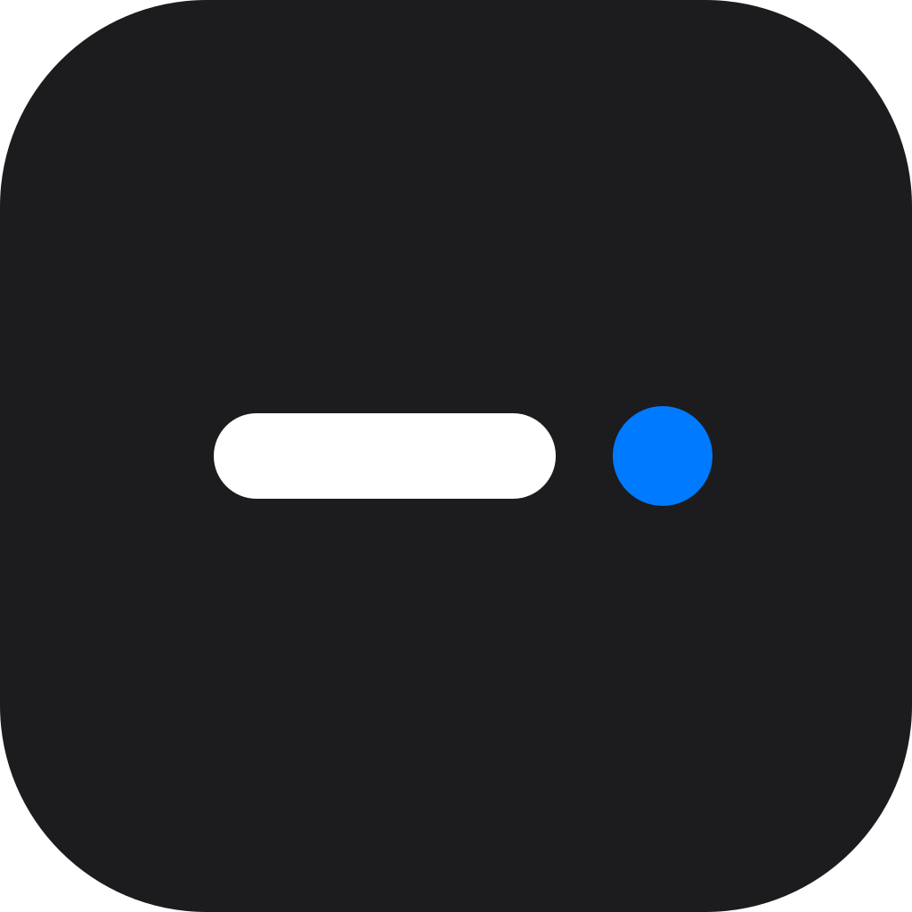
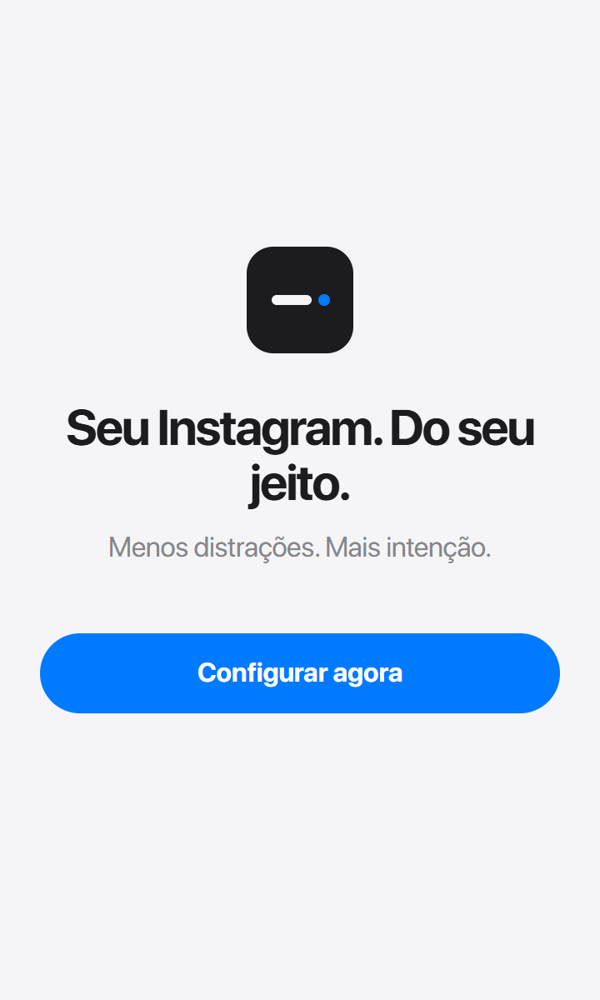
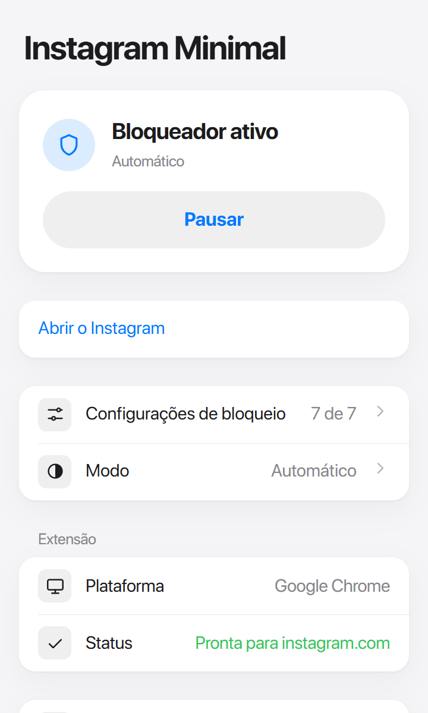
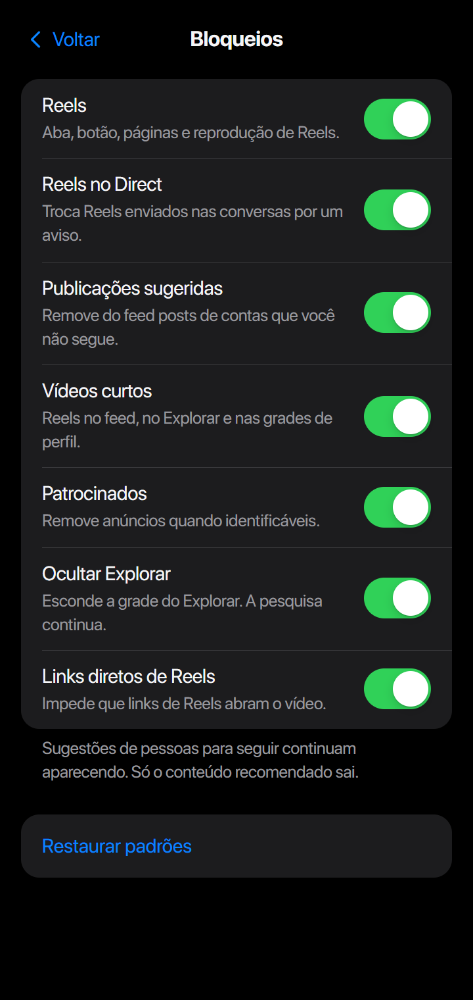

<p align="center"></p>

<h1 align="center">Instagram Minimal</h1>

<p align="center"><strong>Seu Instagram. Do seu jeito.</strong><br>Menos distrações. Mais intenção.</p>

<p align="center">
  <a href="https://bragahauser-byte.github.io/instagram-minimal/">Site</a> ·
  <a href="docs/installation.md">Instalar</a> ·
  <a href="docs/privacy.md">Privacidade</a> ·
  <a href="docs/limitations.md">Limitações</a>
</p>

---

Extensão de navegador, local e de código aberto, que tira do Instagram os mecanismos de consumo infinito — **Reels, vídeos curtos recomendados e publicações sugeridas** — e deixa o resto como está: Direct, Stories, posts de quem você segue, curtidas, comentários, perfis, notificações e publicar.

Não é uma rede social nem um cliente alternativo. Você abre o **instagram.com oficial**, faz login nele como sempre, e a extensão ajusta a página no seu próprio navegador. Nenhuma senha, nenhum servidor, nenhuma telemetria.

<p align="center">
  
  
  
</p>

## O que faz

| | |
|---|---|
| **Reels** | Some a aba Reels (navegação e perfis). Páginas `/reels/`, `/reel/…` e links diretos não abrem: aparece *"Este conteúdo foi bloqueado pelo Instagram Minimal."* e os vídeos são pausados. |
| **Reels no Direct** | O cartão do Reel enviado na conversa vira *"Reel bloqueado."* e não abre. Vídeos comuns enviados na conversa continuam normais. Vale também na janela flutuante de conversa. |
| **Publicações sugeridas** | Somem do feed os posts de contas que você não segue e os blocos de descoberta ("Suggested reels"). **Sugestões de pessoas para seguir continuam.** |
| **Vídeos curtos** | Reels de contas seguidas no feed, no Explorar e nas grades de perfil viram um aviso discreto. |
| **Patrocinados** | Anúncios identificáveis somem do feed. |
| **Explorar** | Ocultar a grade ou mantê-la acessível com os filtros aplicados. A busca de pessoas continua. |
| **Três modos** | **Manual** (liga/desliga), **Automático** (sempre ativo; pausas voltam sozinhas) e **Foco permanente** (desativar exige 1 minuto de espera e uma frase; pausas de no máximo 10 min). |

Cada bloqueio liga e desliga separadamente. Tudo fica salvo só no seu navegador.

## Como usar (grátis, qualquer aparelho)

Abra **https://bragahauser-byte.github.io/instagram-minimal/** e siga os passos do seu aparelho: instale um app gratuito de scripts → toque em **Instalar o Instagram Minimal** → **Abrir o Instagram** e entre com sua conta. O site mostra **✓ Instalado** quando terminar.

| Aparelho | Navegador | App grátis |
|---|---|---|
| iPhone | Safari | Userscripts |
| Android | Firefox | Violentmonkey |
| Computador | Chrome / Edge | Tampermonkey |
| Computador | Firefox | Violentmonkey |
| Mac | Safari | Userscripts |

O Chrome do celular e o app do Instagram não aceitam nenhum tipo de complemento, por isso no celular o guia usa o Safari ou o Firefox.

## Plataformas

| Plataforma | Pacote | Situação |
|---|---|---|
| Google Chrome | `dist/chromium` (MV3) | Construída e testada automaticamente (Chromium + Playwright) |
| Microsoft Edge | `dist/chromium` (mesmo pacote) | Construída; mesmo motor do Chrome, não testada à parte |
| Mozilla Firefox | `dist/firefox` (MV3) | Construída; validada com `web-ext lint` no CI; não testada num Firefox real |
| Firefox para Android | `dist/firefox` (`gecko_android`) | Construída; precisa de publicação no AMO para instalar no celular |
| **iPhone (Safari), grátis** | userscript + app gratuito Userscripts | Testado em tela de iPhone simulada (Chromium); **não testado num iPhone real** |
| **Android (Firefox), grátis** | userscript + Violentmonkey | Mesmo script; não testado num Android real |
| Safari macOS e iPhone (app próprio) | `apps/ios` (SwiftUI + Safari Web Extension) | Código e projeto prontos; compilação verificada pelo CI em macOS; **não instalado num aparelho** (precisa de Mac, Xcode e conta Apple) |

Detalhes em [docs/installation.md](docs/installation.md) e [docs/publishing.md](docs/publishing.md).

## Como foi verificado

- **124 testes unitários** (Vitest + jsdom) com páginas fictícias que reproduzem a estrutura real do Instagram: classificação de posts, links, Direct, Explorar, perfis, Stories, os três modos, persistência e navegação entre seções.
- **19 testes ponta a ponta** (Playwright) num **Chromium de verdade com a extensão compilada**, contra um Instagram simulado servido em `https://www.instagram.com/` (sem tocar a internet): popup, modos, persistência após recarregar, navegação SPA, regra de rede para links diretos e o Direct.
- **Teste manual no instagram.com real** (26/nov/2026, logado, Chrome desktop) do mesmo motor dos filtros: anúncios e sugeridos removidos, vídeos comuns preservados, Reels do Direct bloqueados (inclusive na janela flutuante), clique no cartão bloqueado não abre, Explorar oculto/acessível. Ver [docs/limitations.md](docs/limitations.md).

```bash
npm ci
npm run typecheck && npm test   # unitários
npm run test:e2e                # Chromium real com a extensão
```

## Estrutura

```
packages/
  core/        modelo de configuração, regras dos modos, armazenamento (puro, testável)
  filters/     identificação de componentes e motor de bloqueio (seletores em selectors.ts)
  shared-ui/   design system e telas em React, usados no popup, nas opções e no site
extensions/
  common/      content script, background, popup, opções, página de bloqueio
  chromium/    manifest Chrome/Edge
  firefox/     manifest Firefox (desktop e Android)
  safari/      manifest Safari
apps/
  dashboard/   site do projeto (GitHub Pages) com prévia interativa
  ios/         app SwiftUI + Safari Web Extension (iOS e macOS, XcodeGen)
  android/     notas do Firefox para Android
tests/         unitários, ponta a ponta e páginas fictícias
docs/          arquitetura, privacidade, instalação, seletores, publicação, limitações
```

Arquitetura completa em [docs/architecture.md](docs/architecture.md).

## Privacidade

Sem senha, sem conta, sem servidor, sem analytics, sem anúncios. Permissões: acesso a `instagram.com`, `storage`, `declarativeNetRequest` e `alarms` — cada uma explicada em [docs/privacy.md](docs/privacy.md).

## Licença

[MIT](LICENSE). Projeto independente, não afiliado, patrocinado ou aprovado pela Meta ou pelo Instagram. "Instagram" é marca da Meta Platforms, Inc. e aparece aqui só para descrever com qual site a extensão funciona.
